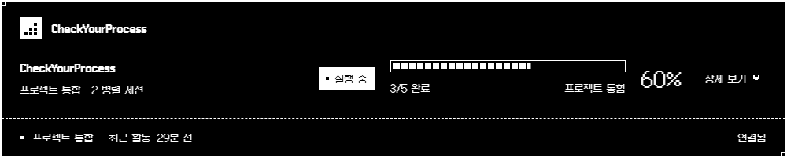

# CheckYourProcess — Beta

Local progress bands for AI desktop tasks, with shared project tracking across parallel sessions.

[한국어 안내](docs/README.ko.md) · [Installation](docs/installation.md) · [Architecture](docs/architecture.md)

Current release: **0.1.0-beta.5**. Start with a small local task; desktop UI and account availability vary by host. See the [beta trial guide](docs/beta.md).

CheckYourProcess combines Ponytail's compact progress-and-details layout with a monochrome 8-bit interface: a task name, activity state, block progress bar, and a details toggle. The bundled Galmuri11 pixel fonts cover both **English** and **한국어** without external font requests. It supports a standalone session or a shared project; changing language updates labels and settings without translating your task titles.

```text
Project name · Running · ██████░░░░ 60% · 3/5 complete
```



[Expanded project view with parallel sessions and language settings](docs/images/project-details.png)

Local preview with test tasks; this screenshot is not a live desktop-host installation.

## Desktop integrations

| Host | Display | Installation artifact |
| --- | --- | --- |
| Claude Code | Native band above the composer, terminal and Desktop (no in-chat card) | Claude Code plugin ZIP |
| Codex | MCP App inline card / internal side panel | Local Codex plugin ZIP |
| Claude Desktop Chat | Inline MCP App card | `.mcpb` desktop extension |
| ChatGPT | MCP App card | Private MCP connection; Secure MCP Tunnel when needed |

The native Claude band uses its official `AbovePrompt` extension point. Other hosts use their supported MCP App surfaces. This project does not patch desktop applications or inject arbitrary UI into their composers.

**Current scope:** Windows, one local user and one local database. The integrations are implemented; individual desktop accounts, UI availability, policies and tunnel access still need end-to-end verification in those hosts. A public GitHub source repository is separate from acceptance into Anthropic's or OpenAI's plugin directories.

## Build and run

Install **Node.js 22.20.0 or later**. This project uses Node's built-in SQLite module; Node 22 may print an experimental-module warning on stderr.

```powershell
npm ci
npm run typecheck
npm test
npm run build
npm start
```

Open the local preview and create a real tracking session:

```powershell
node dist/cli.js preview
```

The preview command prints a local authentication URL. Open that URL locally; do not share it. The preview uses the same stored state as the host extensions.

Create installable packages:

```powershell
npm run package
```

The `release/` directory contains `checkyourprocess-claude-code-0.1.0-beta.5.zip`, `checkyourprocess-codex-0.1.0-beta.5.zip`, and `checkyourprocess-claude-desktop-0.1.0-beta.5.mcpb`, plus staged plugin directories and local marketplace metadata. Each package includes its bundled runtime, documentation and license. No API keys or tracking database are included. See the [installation guide](docs/installation.md) for the four host setup paths.

## Track a task

After installing and enabling the extension, ask the host:

> Start tracking this task. Create a project called “Website” and register these steps: implement, test, review.

In another session or another connected desktop host:

> Join the existing “Website” project. Show its tasks and let me select which existing task IDs this session will work on.

Select the existing project explicitly. The server issues stable project, tracking-session and task IDs. Two sessions can link the same task, but that task counts once in the project's progress. Matching titles are never used to merge tasks automatically.

The card lets you switch **Session / Project**, expand tasks and linked sessions, connect a standalone session to a project, add or link tasks, and choose **한국어 / English**. In Claude Code the native band is the whole interface: its details view pages through every task, switches scope and language, connects a standalone session to an existing project and links project tasks. beta.5 ships Claude Code without the in-chat card (`CYP_CARD=off`); Codex, Claude Desktop Chat and ChatGPT keep the MCP card for these controls.

Progress is completed tasks divided by registered tasks, with equal weights. An empty plan displays “No plan”. Adding tasks can lower the percentage. Ending a reply or a tracking session does not complete unfinished tasks. Explicit progress reports are the source of task state; coding-host hooks report activity without parsing private transcripts.

## Local data and connections

Data is stored in `%USERPROFILE%/.checkyourprocess` by default, outside AppData so packaged desktop apps and terminal sessions share the same location. Set `CYP_DATA_DIR` for a separate local data directory and `CYP_PORT` to change the default loopback port (`49173`). All four integrations must use the same values to share projects. Existing beta.1 databases are preserved without automatic migration; see [upgrading to beta.2](docs/upgrade-beta2.md).

The local service listens on loopback and authenticates requests. Its token and runtime metadata stay outside the repository and never go into the MCP widget. Only explicitly registered task/project/session state is stored; existing chat logs and credentials are not imported.

MCP App cards poll through their host bridge once per second while visible. Polling does not count as agent activity. Disconnections retain the last confirmed values and show a connection warning. Chat-only hosts display the last reported activity rather than claiming access to hidden model thinking.

ChatGPT's remote MCP path may require [Secure MCP Tunnel](https://developers.openai.com/api/docs/guides/secure-mcp-tunnels). The database remains on your PC, but requested task data passes through the connected host. The local service and tunnel client must be running for that connection to work.

Stop the service with `node dist/cli.js stop`. Uninstalling a host extension does not delete your task database.

## Development and distribution

`npm test` covers persistence, aggregation, concurrency, authentication and transport behavior. If Claude Code is installed, run its native mod tests separately:

```powershell
claude plugin test .\integrations\claude-code
```

Publish source under the included MIT license. Build artifacts can be attached to GitHub Releases. Do not upload `.local/`, runtime metadata, tokens, SQLite files or environment files. OpenAI's public plugin directory has separate eligibility requirements; this version's local lifecycle hooks are intended for manual desktop installation.

This is an independent project and is not affiliated with Anthropic, OpenAI or Ponytail. The UI pattern is inspired by Ponytail; the implementation is original.

Galmuri11 font assets retain their [SIL Open Font License 1.1](src/ui/fonts/LICENSE.txt), included in every build. The native Claude Code band keeps the host text font while using monochrome block graphics and borders.
