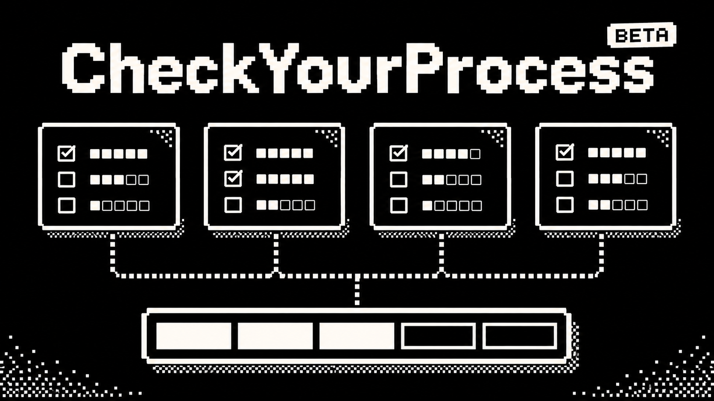

# CheckYourProcess — Beta

**AI에게 맡긴 작업이 어디까지 진행됐는지, 지금 무엇을 기다리는지 한눈에 확인합니다.**



[English](docs/README.en.md) · [설치 안내](docs/installation.md) · [베타 확인 항목](docs/beta.md) · [함께 개발하기](CONTRIBUTING.md) · [오류 해결](docs/troubleshooting.md)

현재 버전은 **0.1.0-beta.5**입니다. Windows의 한 사용자·한 PC를 기준으로 개발한 사이드 프로젝트입니다. **설치 → 첫 작업 추적 → 상태 갱신 → 재시작 후 복원**이 매끄럽게 이어지는 것을 베타의 우선 목표로 삼고 있습니다. 플랫폼별 실제 앱 검증은 진행 중이며, 모든 앱에서 같은 화면과 기능을 보장하는 정식 버전은 아닙니다.

## 왜 만들었나요?

울트라코드로 서브 에이전트들에게 일을 맡겼을 때 진행 상황을 파악하기 어려워 만들기 시작했습니다. AI와 긴 작업을 하거나 여러 대화를 병렬로 진행하면, 대화 내용을 다시 읽어야 남은 일을 파악하기 쉽습니다. CheckYourProcess는 합의한 작업 목록과 완료 수, 실행·대기·중단 상태를 작은 패널로 모읍니다. 같은 프로젝트에 연결한 여러 세션의 진행률도 함께 확인할 수 있습니다.

작업의 **완료율**과 에이전트의 **활동 상태**를 구분합니다. 응답이 끝났다고 작업을 완료 처리하거나, AI의 내부 사고·남은 시간을 추측하지 않습니다. 표시되는 진행률은 등록한 계획을 기준으로 합니다.

## 현재 할 수 있는 일

- 요청한 세션만 추적하고 작업을 등록·진행·완료로 갱신합니다.
- 세션별 보기와 프로젝트 통합 보기를 전환합니다. 같은 작업 ID를 여러 세션에 연결해도 한 번만 집계합니다.
- 흑백 8비트 진행 바와 상세 목록으로 완료 수·활동 상태를 확인합니다.
- 한국어·English 표시를 전환하고 작업·언어 설정을 로컬에 보관합니다.
- 코딩 호스트가 지원하는 훅으로 활동을 반영합니다. 지원하는 계획 도구의 목록 반영과 서브 에이전트 표시는 호스트별 검증 범위가 다릅니다.

```text
웹사이트 · 실행 중 · ██████░░░░ 60% · 3/5 완료
```


위 패널과 [프로젝트 상세 화면](docs/images/project-details.png)은 테스트 작업을 넣은 로컬 미리보기입니다. 상단 대표 이미지는 소개용 일러스트입니다.

## 플랫폼별 사용 방식

| 플랫폼 | 현재 연결·표시 방식 | 먼저 개선할 지점 |
| --- | --- | --- |
| Claude Code | 플러그인 ZIP, 입력창 위 네이티브 바와 상세 보기. 터미널·Desktop의 Code 탭 대상 | 설치·업데이트, 훅과 병렬 작업 상태, 실제 화면 배치 |
| Claude Desktop | `.mcpb` 확장, 일반 Chat 탭의 MCP App 카드 | 확장 설치, 카드 연결·재연결, 재시작 후 복원 |
| Codex CLI | Codex 플러그인 또는 stdio MCP, 도구 응답으로 상태 확인·로컬 미리보기 | CLI 설치, 계획·활동 훅 대응, 상태 보고 흐름 |
| ChatGPT | 개인 커스텀 MCP 연결, MCP App 카드. 로컬 서버 연결에 별도 터널 설정 필요 | 계정별 연결 안내, 터널 진단, 카드 갱신 |

Codex **앱**에는 카드·내부 사이드 패널 경로도 있습니다. CLI에서 같은 카드가 표시된다고 가정하지 않습니다. Claude Desktop의 **Code 탭**은 Claude Code 플러그인을, **Chat 탭**은 `.mcpb`를 사용합니다. 설치 파일 생성과 프로토콜 검증은 실제 앱 설치·화면 검증과 구분하며, [확인 범위](docs/beta.md)에 기록합니다.

## 시작하기

먼저 **Windows와 Node.js 22.20.0 이상**을 준비하세요. Node 설치 후 터미널과 대상 앱을 다시 열고 `node --version`, `npm --version`이 실행되는지 확인합니다. Node 22에서는 내장 SQLite의 실험 기능 안내가 나올 수 있습니다.

**[베타 릴리스](https://github.com/SWJoong/CheckYourProcess/releases/tag/v0.1.0-beta.5)**에서 사용할 플랫폼의 파일 하나를 내려받고 [앱별 설치 안내](docs/installation.md)를 따르세요. 패키지 사용에는 Git이나 소스 빌드가 필요하지 않습니다.

| 플랫폼 | 다운로드 |
| --- | --- |
| Claude Code | [플러그인 ZIP](https://github.com/SWJoong/CheckYourProcess/releases/download/v0.1.0-beta.5/checkyourprocess-claude-code-0.1.0-beta.5.zip) |
| Claude Desktop Chat | [데스크톱 확장 `.mcpb`](https://github.com/SWJoong/CheckYourProcess/releases/download/v0.1.0-beta.5/checkyourprocess-claude-desktop-0.1.0-beta.5.mcpb) |
| Codex CLI / 앱 | [플러그인 ZIP](https://github.com/SWJoong/CheckYourProcess/releases/download/v0.1.0-beta.5/checkyourprocess-codex-0.1.0-beta.5.zip) |
| ChatGPT | 압축을 푼 패키지의 `dist/stdio.js`를 별도 터널에 연결 |

패키지에는 런타임이 묶여 있어 압축 해제 후 `npm install`이 필요하지 않습니다. **Node.js 자체는 필요**합니다. 모든 플랫폼을 설치할 필요는 없습니다. ChatGPT 연결은 계정·워크스페이스와 터널 권한을 따로 확인해야 합니다.

### 소스에서 빌드하기

직접 개발하려면 Git으로 소스를 받습니다. `release/`는 생성 폴더이므로 GitHub의 **Source code ZIP**이나 클론에는 설치 패키지가 포함되지 않습니다.

```powershell
git clone https://github.com/SWJoong/CheckYourProcess.git
cd CheckYourProcess
npm ci
npm run package
```

`npm run package`는 빌드와 세 설치 파일 생성을 함께 수행합니다. 오류가 나면 다음 단계로 넘어가기 전에 [오류 해결](docs/troubleshooting.md)을 확인하세요.

앱에 연결하기 전 로컬 화면부터 확인하려면 빌드한 폴더 또는 압축을 푼 패키지 폴더에서 실행하세요.

```powershell
node dist/cli.js preview
```

서비스가 시작되고 일회용 인증 URL이 출력됩니다. 같은 PC의 브라우저에서 여세요. URL은 공유하지 마세요. 미리보기만 성공한 상태와 앱 연결 완료는 별개입니다.

## 첫 작업을 추적해 보세요

확장 설치 후 앱을 다시 열고 새 대화에서 요청합니다. Claude Code에서는 `/checkyourprocess:track` 또는 바의 **추적 시작**을 사용할 수 있습니다.

> CheckYourProcess로 이 작업의 추적을 시작해 주세요. ‘베타 테스트’ 프로젝트를 만들고, 구현·검증·리뷰 세 작업을 등록해 주세요. 현재 진행률을 보여 주세요.

첫 확인은 `0/3 → 1/3 (33%)`입니다. 작은 작업을 실제로 마친 뒤 그 작업을 완료로 갱신하도록 요청하세요. Claude Code는 바의 **상세**, 카드 지원 앱은 **상세 보기**, CLI는 도구 응답이나 로컬 미리보기로 확인합니다.

다른 세션에서도 함께 진행하려면 다음처럼 요청합니다.

> 기존 ‘베타 테스트’ 프로젝트 목록을 보여 주세요. 내가 고른 프로젝트 ID에 참여하고 기존 작업 ID를 연결해 주세요. 같은 작업을 새로 등록하지 마세요.

완료율은 `완료 작업 수 / 등록 작업 수`이며 가중치는 같고 소수점은 버립니다. 계획이 없으면 **계획 없음**으로 표시하고, 새 작업을 추가하면 완료율이 내려갈 수 있습니다. 응답 종료·추적 종료는 미완료 작업을 완료로 바꾸지 않습니다. 추적은 매 세션에서 명시적으로 시작합니다.

## 베타 범위와 개발 단계

| 단계 | 목표와 완료 기준 | 상태 |
| --- | --- | --- |
| 1. 공통 기반 | 작업 저장, 고유 ID 집계, 인증, 한국어·영어, 패키지 생성 | 구현됨. 자동 테스트와 배포물 검증은 [베타 기록](docs/beta.md) 참고 |
| 2. 설치·기본 동작 안정화 | 새 환경에서 설치, 첫 추적, 상태 갱신, 연결 복구, 재시작 후 복원을 플랫폼별로 재현 | **현재 우선순위** |
| 3. 플랫폼별 최적화 | 각 호스트의 화면·계획 도구·활동 이벤트에 맞춰 개선 | 공통 베타 위에서 순차 진행 |
| 4. 사용성·기능 개선 | 반복 피드백을 근거로 표시와 작업 관리 흐름 개선 | 설치·작동 안정화 후 진행 |

현재 베타는 Windows·단일 사용자·같은 PC의 공통 저장소를 대상으로 합니다. 여러 개발자의 PC 사이에 진행률을 동기화하는 협업 서비스는 포함하지 않습니다. macOS·Linux, 모든 호스트의 자동 계획 동기화, 스토어 등록은 향후 검토 범위입니다.

지원하는 계획 목록은 추적을 시작한 뒤 반영됩니다. 계획 항목의 제목 변경은 새 작업으로 잡힐 수 있고, 서브 에이전트의 백그라운드 이벤트 순서 등은 추가 실측이 필요합니다. [설계·검증 기록](docs/design-auto-progress.md)에 구체적인 한계를 남깁니다.

## 함께 개발할 분을 찾습니다

ChatGPT / Claude Desktop / Claude Code / Codex CLI를 평소 사용하는 분들과, 각자 익숙한 플랫폼의 설치와 기능을 함께 다듬고 싶습니다. 사이드 프로젝트이므로 한 플랫폼의 설치 재현, 오류 보고, 문서 수정처럼 작은 참여도 환영합니다.

참여하려면 [GitHub 이슈](https://github.com/SWJoong/CheckYourProcess/issues)에 **관심 플랫폼, 사용 환경·버전, 개선하고 싶은 문제, 가능한 참여 범위**를 남겨 주세요. [기여 안내](CONTRIBUTING.md)에 첫 작업과 검증 방법을 정리했습니다. 공통 저장·집계·인증은 유지하고 플랫폼별 연결 부분부터 개선합니다.

구조·사용 방법·나누어 개발하는 순서를 한 장에 모은 [안내서(HTML)](docs/guide.html)도 있습니다. GitHub 화면에서는 소스 코드로 보이므로, 파일을 내려받아 브라우저에서 여세요.

### 어떻게 나누어 맡나요

플랫폼 하나씩 맡는 것을 기본으로 합니다. 새 기능보다 **내 플랫폼에서 설치 → 첫 추적 → 재시작 후 복원까지 해 보고 결과를 남기는 일**을 첫 과제로 권합니다. 막힌 지점이 다음 개선 과제가 됩니다.

| 담당 | 주로 보는 위치 | 첫 과제 예시 |
| --- | --- | --- |
| Claude Code (Desktop의 Code 탭 포함) | `integrations/claude-code/` | 설치·업데이트 재현, 바 표시 확인, 훅과 병렬 작업 상태 |
| Claude Desktop (Chat 탭) | `integrations/claude-desktop/` | `.mcpb` 설치, 카드 연결·재연결 |
| Codex CLI·앱 | `integrations/codex/` | 설치 재현, 계획·활동 이벤트 차이 기록 |
| ChatGPT | `src/stdio.ts`, [설치 안내](docs/installation.md)의 ChatGPT 절 | 계정별 연결·터널 안내 재현 |
| 문구·문서 (코드 없이 가능) | `docs/`, `README.md`, 화면 문구 | 한국어·영어 문구 다듬기, 설치 안내를 처음 보는 사람의 눈으로 확인 |

- **공통 영역은 유지 관리자가 맡습니다.** 저장·집계·인증·번역(`src/store.ts`, `src/service.ts`, `src/types.ts`, `src/mcp.ts`, `src/runtime.ts`, `src/i18n.ts`), 공용 카드(`src/ui/`), 훅 전달(`integrations/shared/`)은 모든 플랫폼이 함께 쓰므로, 바꾸고 싶다면 먼저 이슈로 범위를 정한 뒤 테스트와 함께 작은 PR로 보내 주세요.
- **AI 코딩 도구를 쓰는 참여를 전제로** 지켜야 할 규칙을 [AGENTS.md](AGENTS.md)에 적었습니다(Claude Code는 `CLAUDE.md`를 통해 읽습니다). 리뷰 담당은 [`.github/CODEOWNERS`](.github/CODEOWNERS), 이슈·PR 양식은 `.github/` 폴더에 있습니다. PR은 CI(Windows에서 타입 검사·테스트·패키징)를 통과한 뒤 병합하는 것을 원칙으로 합니다.
- **지어낸 데이터만 씁니다.** 실제 이용자·사례 같은 개인 정보, 인증 URL, 토큰, 로그를 작업 이름·스크린샷·이슈·PR에 넣지 마세요.

함께할 분이 모이지 않아도 개발을 이어갑니다. 현재 검증 기반이 있는 **Claude Code → Claude Desktop → Codex CLI → ChatGPT** 순으로 설치와 기본 작동을 직접 다듬을 예정입니다. 모집 인원이나 출시 날짜를 전제로 진행하지 않습니다.

## 시연 영상

두 영상 모두 **소리 없는 배속 요약본**이며, 자막과 빨간 사각형으로 확인할 부분을 표시했습니다. 같은 영상을 유튜브 Shorts에 올렸고, 영상 파일은 저장소의 `docs/videos/`에도 포함합니다.

| 영상 | 보여 주는 흐름 |
| --- | --- |
| Claude Code 터미널 · 56초<br>[유튜브](https://www.youtube.com/shorts/55RuXNqQ_DI) · [영상 파일](https://github.com/SWJoong/CheckYourProcess/blob/main/docs/videos/shoot-auto-summary.mp4) | 추적 시작, 작업 3개 등록, 33%, 상세·언어 전환, 두 번째 세션 연결, 66%, 종료·서비스 재시작·명시적 재개 |
| Claude Desktop Code 탭 · 약 45초<br>[유튜브](https://www.youtube.com/shorts/22EMteCGKSk) · [영상 파일](https://github.com/SWJoong/CheckYourProcess/blob/main/docs/videos/desktop-code-summary.mp4) | 새 Code 세션에서 작업 5개 등록, 진행 바 갱신, 5/5·100%, 추적 종료 |

터미널 영상은 Claude Code **2.1.323**의 전체 화면 렌더러를 사용했습니다. **키·마우스 입력은 자동화 도구로 주입**했고, 모델 응답과 도구 호출은 실제 Claude Code에서 실행됐습니다. Desktop 영상은 **Claude Desktop 5.11492의 Code 탭**이며 사이드바 자르기·계정 메뉴 가림 처리를 했습니다. 일반 Chat 탭의 `.mcpb` 카드를 시연한 영상은 아닙니다.

[영상 설명·확인 범위](docs/videos/README.md) · [촬영·리허설 기록](docs/demo.md) · [카톡 공유 글과 영상 캡션](docs/kakao-share.txt)

## 개발·데이터 안내

```powershell
npm run typecheck
npm test
claude plugin test integrations/claude-code
```

마지막 명령은 Claude Code가 설치된 환경에서만 실행합니다. 일반 Node 테스트와 네이티브 바 테스트는 별도입니다. [구조 설명](docs/architecture.md)에서 공통 서비스와 플랫폼별 연결 지점을 확인할 수 있습니다.

작업은 기본적으로 `%USERPROFILE%/.checkyourprocess`에 저장합니다. `CYP_DATA_DIR`, `CYP_PORT`를 바꾸면 모든 연결에서 같은 값을 사용하세요. 기본 포트는 `49173`입니다. beta.1에서 올라온다면 [저장 경로 변경 안내](docs/upgrade-beta2.md)를 먼저 확인하세요. 서비스 종료는 `node dist/cli.js stop`이며, 확장 제거만으로 데이터는 삭제되지 않습니다.

기존 대화 로그를 가져오지 않습니다. 추적 중인 작업·프로젝트·세션 상태와 지원하는 계획 도구의 작업명·상태가 로컬 서비스에 반영됩니다. 카드가 보이는 동안 1초 간격으로 조회하며 조회 자체는 활동으로 세지 않습니다. 연결이 끊기면 마지막 값을 유지하고 오류를 표시합니다. AI 호스트나 터널로 요청한 작업 정보는 해당 연결을 거칩니다. 인증 URL·토큰·DB·개인 로그는 공개 이슈나 영상에 넣지 마세요. 자세한 내용은 [보안 안내](SECURITY.md)를 참고하세요.

소스는 [MIT](LICENSE), Galmuri11 폰트는 [SIL OFL 1.1](https://github.com/SWJoong/CheckYourProcess/blob/main/src/ui/fonts/LICENSE.txt)로 배포합니다. Anthropic·OpenAI·Ponytail과 제휴하지 않은 독립 프로젝트입니다. Ponytail의 간결한 진행·상세 표시 방식에서 영감을 받아 구현했습니다. GitHub 공개와 각 회사의 플러그인 디렉터리 등록은 별도입니다.
