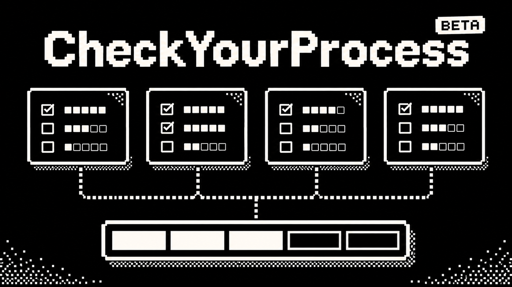
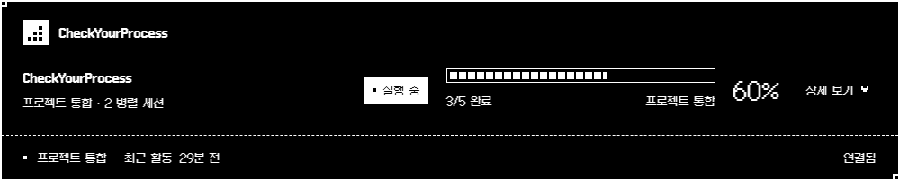

# CheckYourProcess — Beta

Local task progress for AI conversations: see completed steps, current activity and shared project progress across parallel sessions on the same PC.



[한국어](../README.md) · [Installation](installation.md) · [Beta checks](beta.md) · [Contributing](../CONTRIBUTING.md) · [Troubleshooting](troubleshooting.md)

Current version: **0.1.0-beta.5**. This is a Windows side project for one local user. The immediate priority is reliable installation, first tracking, updates, reconnection and persistence. Host installation and UI verification remain in progress; generated packages and protocol tests do not establish compatibility with every account.

## Purpose and features

Long tasks and parallel AI conversations make it hard to tell what remains. CheckYourProcess keeps the agreed task list, completion count and running/waiting/interrupted state together in a compact monochrome panel.

- Opt in per session; register and update concrete tasks.
- Switch between session and project views. Link canonical task IDs across sessions without double-counting project progress.
- Use Korean or English labels with bundled Galmuri11 fonts; user task titles stay unchanged.
- Keep task state and language settings locally across restarts.
- Receive supported activity and plan events from coding-host hooks. Automatic plan and sub-agent support varies by host; see the [design and verification record](design-auto-progress.md).

Progress is completed tasks divided by registered tasks, with equal weights and the percentage rounded down. No plan means unknown progress. Adding tasks can reduce the percentage. Ending a reply or tracker never completes unfinished work. Activity is distinct from progress and does not claim access to hidden model thinking or estimate remaining time.



The cover is an illustration. This panel and the [expanded project view](images/project-details.png) are local previews with test tasks, not proof of a live host installation.

## Platforms

| Platform | Integration | First improvement area |
| --- | --- | --- |
| Claude Code | Plugin ZIP; native AbovePrompt band on terminal/Desktop Code | Installation, updates, lifecycle hooks, real layout |
| Claude Desktop Chat | `.mcpb`; inline MCP App card | Extension installation, card reconnection and persistence |
| Codex CLI | Plugin or stdio MCP; tool results/local browser preview | CLI setup, plan/activity adapters and reporting |
| ChatGPT | Private custom MCP connection and card; separate tunnel setup for the local server | Account setup, tunnel diagnostics and refresh |

The Codex desktop app also has card/internal side-panel paths; the CLI is documented separately. Claude Desktop's Code tab uses the Claude Code plugin, while Chat uses `.mcpb`.

## Build and install

Use **Windows and Node.js 22.20.0 or later**. Restart terminals and hosts after installing Node and check `node --version` and `npm --version`. Node 22 can print an experimental SQLite warning.

Download the package for your host from the **[beta release](https://github.com/SWJoong/CheckYourProcess/releases/tag/v0.1.0-beta.5)** and follow the [installation guide](installation.md). Prebuilt packages need no Git checkout or source build.

- [Claude Code plugin ZIP](https://github.com/SWJoong/CheckYourProcess/releases/download/v0.1.0-beta.5/checkyourprocess-claude-code-0.1.0-beta.5.zip)
- [Claude Desktop Chat extension](https://github.com/SWJoong/CheckYourProcess/releases/download/v0.1.0-beta.5/checkyourprocess-claude-desktop-0.1.0-beta.5.mcpb)
- [Codex CLI / desktop plugin ZIP](https://github.com/SWJoong/CheckYourProcess/releases/download/v0.1.0-beta.5/checkyourprocess-codex-0.1.0-beta.5.zip)

Archives contain the bundled runtime, documentation and licenses; the extracted copy needs Node but no `npm install`. ChatGPT can use the extracted `dist/stdio.js` through a separately configured private connection, with account/workspace and tunnel permissions.

### Build from source

For development, clone with Git and build the same packages:

```powershell
git clone https://github.com/SWJoong/CheckYourProcess.git
cd CheckYourProcess
npm ci
npm run package
```

Packaging includes the build. Stop and resolve errors before continuing. `release/` is generated and is absent from a source clone/ZIP. GitHub's source archives are different from the installable release assets.

To check the local screen before connecting a host, run from the built repository or extracted package:

```powershell
node dist/cli.js preview
```

Open the printed one-use authentication URL locally and keep it private. This starts the service as needed. A successful preview does not prove a host connection.

## First tracked task

After installing, restart the host and ask in a new conversation:

> Start CheckYourProcess tracking. Create a “Beta test” project with implement, verify and review steps, and show the current progress.

Confirm 0/3, then finish one real step and have the host update it to 1/3 (33%). Claude Code uses its band's details view; card-capable hosts use the card; CLI users can read tool results or open the preview. Claude Code also supports `/checkyourprocess:track`.

To join from another session, explicitly select the existing project ID and link existing task IDs. Matching names do not establish identity. Installing the extension alone does not start tracking or import old conversations.

## Development stages and participation

1. **Shared foundation:** persistence, canonical task aggregation, authentication, bilingual UI and packaging are implemented.
2. **Current priority:** reproduce installation, tracking, updates, recovery and restart on each host. Record observed versions and results in the [beta checks](beta.md).
3. **Platform improvements:** optimize the UI, plan adapters and lifecycle events for each host after its basic path works.
4. **Further usability/features:** prioritize recurring feedback after installation and operation are reliable.

This beta uses one local database on one PC. Cross-PC collaboration, macOS/Linux validation, universal automatic plan synchronization and store listings are future considerations. Renaming a plan item can create a new task; some background sub-agent event sequences need further observation.

Contributors can focus on **ChatGPT, Claude Desktop, Claude Code or Codex CLI**. Installation reports, documentation and small fixes are welcome. Open a [GitHub issue](https://github.com/SWJoong/CheckYourProcess/issues) with your platform/version, the problem and the scope you can take on. See [Contributing](../CONTRIBUTING.md) for starter tasks and shared invariants.

Development will continue even without contributors, in the initial order Claude Code → Claude Desktop → Codex CLI → ChatGPT. There is no fixed recruitment or release schedule.

## Demo videos

Both videos are silent, speed-edited summaries with captions and red highlights. The files are included under `docs/videos/` in the repository; open their links to view the file page or download them.

| Video | Demonstrated flow |
| --- | --- |
| [Claude Code terminal · 56 seconds](https://github.com/SWJoong/CheckYourProcess/blob/main/docs/videos/shoot-auto-summary.mp4) | Three tasks, 33%, details/language, a second session sharing task IDs, 66%, service restart and explicit resume |
| [Claude Desktop Code tab · about 45 seconds](https://github.com/SWJoong/CheckYourProcess/blob/main/docs/videos/desktop-code-summary.mp4) | A fresh Code session, five tasks, progress updates, 5/5 at 100%, and ending tracking |

The terminal demo uses Claude Code **2.1.323** in the fullscreen renderer. **Keyboard and mouse inputs were injected by an automation tool**; model responses and tool calls ran in the real host. The Desktop demo uses **Claude Desktop 5.11492's Code tab**, with the sidebar cropped and the account menu masked. It does not demonstrate the general Chat tab's `.mcpb` card. See the [video notes](videos/README.md) and [recording/rehearsal record](demo.md).

## Development and data

```powershell
npm run typecheck
npm test
claude plugin test integrations/claude-code
```

The last command requires Claude Code and runs native band tests separately. See [Architecture](architecture.md) for the shared service and host adapters.

Data defaults to `%USERPROFILE%/.checkyourprocess`. All hosts must use the same `CYP_DATA_DIR` and `CYP_PORT` overrides to share projects; the default port is `49173`. See the [beta.2 migration guide](upgrade-beta2.md) when upgrading from beta.1. Stop with `node dist/cli.js stop`. Uninstalling does not delete task data.

Hooks can send supported plan titles/status and lifecycle identifiers to the local service for tracked sessions; old chat transcripts are not imported. Visible cards poll once per second without counting reads as activity. Disconnections retain the last confirmed values and show an error. Requested task data passes through the connected AI host/tunnel. Keep tokens, authentication URLs, databases and personal logs out of public reports and recordings; see [Security](../SECURITY.md).

Code: [MIT](../LICENSE). Galmuri11: [SIL OFL 1.1](https://github.com/SWJoong/CheckYourProcess/blob/main/src/ui/fonts/LICENSE.txt). Independent of Anthropic, OpenAI and Ponytail. The compact progress/details pattern is inspired by Ponytail. GitHub distribution is separate from vendor directory acceptance.
