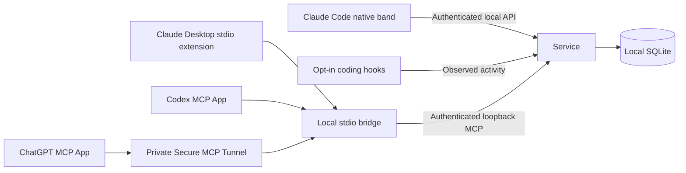

# Architecture

CheckYourProcess has one local Node.js service, a SQLite database, a common MCP server, and host-specific presentation adapters.

The card talks through the MCP host bridge; it never receives the service's bearer token. The native Claude Code mod uses the documented file/network APIs to read local runtime metadata and query the authenticated loopback API. It does not use Node APIs inside the mod runtime.

## State model

- A **project** owns canonical task IDs.
- A **tracking session** belongs to one selected project or starts independently. Its tracker ID is separate from the native host session ID and MCP transport session ID.
- Sessions link to tasks through explicit IDs. A project counts unique task IDs; a session counts its linked tasks. Labels are display text, never identity or deduplication keys.
- A task's revision provides optimistic concurrency. Mutations carry idempotency IDs so retries do not create duplicate work or double-count completions.
- Task completion and activity are separate. A lifecycle `Stop` event cannot mark tasks complete. Snapshot polling does not change the last agent activity time.

User task updates enter through the common tools. Coding-host hooks report lifecycle observations and only affect trackers bound by an opt-in `start_tracking`/`resume_tracking` call. Existing chat transcripts are not imported or parsed.

Two hook inputs go beyond activity, both only to the local service and only for bound trackers:

- **Plan lists.** When a plan tool (`update_plan`, `TodoWrite`) finishes, the relay forwards only each item's text and status. The service mirrors them into the session's tasks: new items add work, an equal title inside the same session reuses its task, and a plan can only move a task forward (it never reopens a completed task or removes a task). Plans raised inside a sub-agent are ignored so they cannot move the parent's total. No other tool input leaves the relay.
- **Sub-agents.** `SubagentStart` and `SubagentStop` keep a per-session set of running sub-agents. A parent `Stop` keeps the session `running` while that set is not empty. A stop without a recorded start (host-internal helpers) is ignored. A background sub-agent (flagged by the parent's `Agent` tool-end) only pauses at `SubagentStop` while it waits on its own commands; it leaves the set at the stop that follows its final report (`SubagentHandback`). One silent for 30 minutes stops being counted. Interrupting or ending a session clears the set. Only the sub-agent ID and these two flags leave the relay.

## Interfaces

The MCP tools cover tracker start/resume/end, project creation/connection, task registration/linking/status updates, activity reporting, snapshots, catalog discovery and settings. `show_progress` opens the common MCP App; its polling tool is app-only to avoid filling the model's tool list or conversation with refresh calls.

The authenticated local API accepts the same named actions. The native-band-only `get_binding` lookup resolves a known native host session to the explicit tracker. `/api/hook` receives normalized coding-host lifecycle events. Service and transport implementations validate inputs before they reach the store.

## Storage and process lifetime

By default, the local data directory is `%USERPROFILE%/.checkyourprocess` (`~/.checkyourprocess` when USERPROFILE is unavailable). Keeping it outside AppData avoids packaged-app virtualization splitting the store and token across hosts. The service stores its local authentication material and runtime metadata there, alongside the SQLite state. Runtime launchers authenticate a health check before reusing the service and never terminate an unknown process occupying the selected port. The `CYP_DATA_DIR` override still takes precedence. Legacy beta.1 databases are never automatically moved or merged.

The default UI language is Korean. Selecting English persists a global setting in the local store; all host views read it on their next refresh. User-created text remains unchanged.

There is no cloud database or server-side AI request in this project. Hosts can still receive the task records requested through their MCP connections. ChatGPT tunnel credentials belong to the user's local tunnel setup, not the project package.

## Limits

This version targets Windows personal installations. It does not promise hidden model-thinking telemetry, elapsed-time-derived completion estimates, historical chat import, public plugin-directory eligibility, cross-PC synchronization, or automatic semantic merging of similarly named tasks. New registered work can legitimately reduce the completion percentage.
